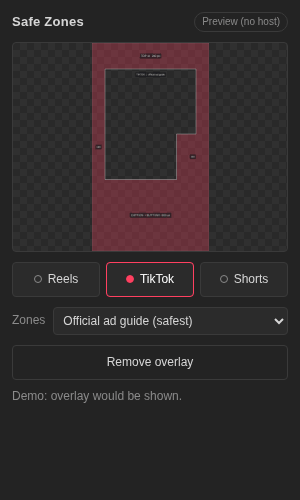
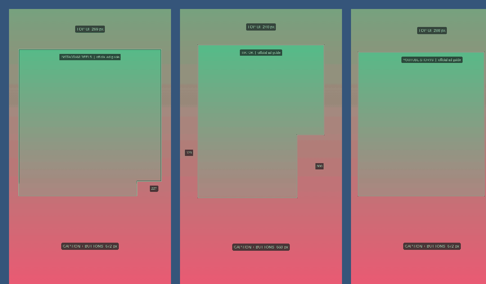

# Safe Zone Panel

A small panel for **Adobe Premiere Pro** and **After Effects** that shows where Instagram Reels, TikTok and YouTube Shorts cover your video with their buttons, captions and tabs. Click a platform, the overlay appears on top of your footage. Click again, it hides.



- **After Effects:** the overlay is added as a locked **guide layer**. Guide layers are not rendered by default, so it cannot end up in your export.
- **Premiere Pro:** the overlay is placed on a new top video track. Premiere has no guide layers, so click the button again to hide it (the clip is disabled and will not export). **Hide it before you export.** The clip is named `!! SAFEZONE - HIDE BEFORE EXPORT !!`, gets a red project label, and the panel shows a flashing red banner while it is on. Adobe gives plug-ins no way to hook the start of an export, so nothing can block or warn at export time. This is a limit of Premiere, not something we can add.
- Works on vertical sequences (1080x1920) and on 16:9 sequences (the 9:16 frame is drawn centred, with the outside dimmed).

## What the overlay shows

Red shading is the area the app covers. The white outline is the safe area. Numbers are pixel margins on a 1080x1920 frame.



| Platform | Top | Bottom | Left | Right | Notes |
| --- | --- | --- | --- | --- | --- |
| Instagram Reels | 269 | 672 | 65 | 65 | Button rail: right margin grows to 227 below y=1150 |
| TikTok | 240 | 660 | 120 | 120 | Button rail: right margin grows to 300 below y=840 |
| YouTube Shorts | 288 | 672 | 48 | 192 | |

The panel has a **Style** dropdown: safe-zone shading (default), **App UI icons** (thin wireframe outlines of the like / comment / share rail, avatar, username, caption and so on), or both. Reels and Shorts wireframe positions are traced from real app screenshots. TikTok follows CapQA's measured organic layout (button rail x 918-1080, y 730-1536; bottom block from y 1570), with icon spacing inside those bounds estimated. The top Shorts search/menu icons and title sit outside the 9:16 video, so they are not drawn. Move or resize elements in `drawUI` in [`js/overlay.js`](js/overlay.js).

Each platform has two zone modes in the panel:

- **Official ad guide (default, safest).** Taken from the platforms' own ad guides and templates: Meta Ads Guide (14% top, 35% bottom, 6% sides), TikTok Ads Manager In-Feed template, Google Ads Help vertical video guidance.
- **Organic, measured in app.** Tighter margins measured from the live apps. The platforms publish no official numbers for normal posts, so treat these as a guide.

Apps change their layouts. The numbers live in [`js/zones.js`](js/zones.js). Edit them, reinstall, and the panel draws the new overlay. The PNGs are generated by the panel when you click a button, so there are no image files to keep in sync.

Sources checked October 2026: [adchecklab.com/specs](https://adchecklab.com/specs), [solidlabs.com/social-safe-zones](https://www.solidlabs.com/social-safe-zones), [storycut.com Reels](https://www.storycut.com/tools/instagram-reels-safe-zone), [revid.ai Shorts](https://www.revid.ai/youtube-shorts-safe-zone), [adkit.so TikTok](https://adkit.so/tools/safe-zones/tiktok), [cadenus.io Reels](https://cadenus.io/resources/blog/instagram-safe-zone/).

## Install (no coding needed)

You need Premiere Pro 2020 or newer and/or After Effects 2020 or newer. The panel is a CEP extension.

1. Click **Code > Download ZIP** on this page and unzip it.
2. **Mac:** open Terminal, type `bash ` (with a space), drag `install/install-mac.sh` into the window, press Enter.
   **Windows:** double-click `install/install-win.bat`.
3. Fully quit and reopen Premiere Pro / After Effects.
4. Open **Window > Extensions > Safe Zones** (in After Effects it may be under **Window > Extensions (Legacy)**).

The installer copies the panel to Adobe's per-user extensions folder and turns on "PlayerDebugMode", which Adobe requires for any panel that is not a signed `.zxp`. To uninstall, delete the folder `com.krshnaprsad.safezonepanel` from:

- Mac: `~/Library/Application Support/Adobe/CEP/extensions/`
- Windows: `%APPDATA%\Adobe\CEP\extensions\`

## How to use

1. Open a composition (AE) or sequence (Premiere) and click on it so it is the active one.
2. Pick **Reels**, **TikTok** or **Shorts**. Choose the zone mode.
3. Keep captions, faces and logos inside the white outline.
4. Click the same button again to hide it, or **Remove overlay** to delete it.

In Premiere the overlay image is generated at your sequence size, so any resolution works. In After Effects the layer is scaled to the comp.

## Where the overlay image goes

When you click a platform, the panel draws the overlay (1080x1920 for vertical comps, 1920x1080 for landscape) and saves it as `SAFEZONE_<platform>_<mode>_<portrait|landscape>.png` in a `SafeZonePanel` folder inside your Adobe user data folder, then imports it. You can also use those PNGs on their own.

## Status and honest limits

Built without access to Premiere or After Effects, so it was checked in these ways only:

- the ExtendScript parses as ES3 and its logic passes tests against mock After Effects and Premiere objects (`node tests/host.test.js`)
- the panel UI was rendered and screenshotted in Chrome
- the overlay drawing code was rendered in Chrome and inspected by eye for all three platforms, portrait and landscape

It has **not** been run inside the real apps yet. If something fails, open an issue with your app version and the message shown in the panel. Adobe is moving to UXP panels over time; CEP still works in current releases but a UXP version may come later.

## Project layout

```
CSXS/manifest.xml        panel registration
index.html, css/, js/    panel UI, zone numbers (js/zones.js), overlay drawing (js/overlay.js)
jsx/host.jsx             ExtendScript that talks to Premiere / After Effects
tests/host.test.js       mock-host tests (node tests/host.test.js)
install/                 Mac and Windows installers
docs/                    README images
```

MIT licensed.
